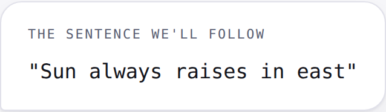
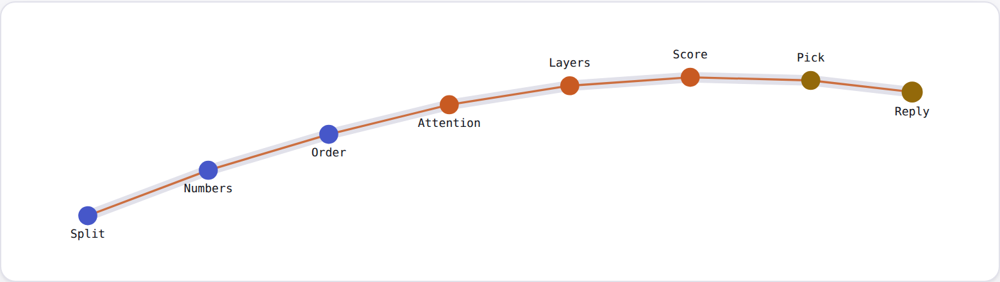

# AI Fundamentals: Anatomy of a Reply

**Run real code against a real language model and watch, number by number, what happens between pressing Enter and seeing a reply.**

This repo is the hands-on companion to my **AI Fundamentals** series on Medium. [Part 1](https://medium.com/@sakthi82/i-typed-a-broken-sentence-into-an-ai-heres-everything-that-happened-in-the-next-second-f7bfef273d3d) traces one deliberately broken sentence through the eight stages of a language model. These scripts let you run those stages yourself, and [Part 2](https://medium.com/@sakthi82/i-ran-a-real-ai-model-on-my-laptop-the-numbers-didnt-match-my-diagrams-1985d8059d53) walks through their real output and the machine learning algorithm behind each one. [Part 3](https://medium.com/@sakthi82/i-asked-an-ai-who-first-walked-on-mars-it-gave-me-five-different-answers-decf2bf126e4) uses them to measure why models make things up.

> **"Sun always raises in east"**



There are two kinds of scripts:

- **01–05** use a real pretrained model: **GPT-2 small** (124M parameters, ~500 MB download). You're looking at genuine learned weights, not a toy.
- **06** builds and trains a tiny Transformer **completely from scratch**, with no pretrained weights. You watch gradient descent shape the model in under a minute, on a CPU.

---

## The series

| Part | Article | Code in this repo |
| --- | --- | --- |
| 1 | **[The Anatomy of a Reply](https://medium.com/@sakthi82/i-typed-a-broken-sentence-into-an-ai-heres-everything-that-happened-in-the-next-second-f7bfef273d3d)**: the eight stages from your message to the model's answer | Diagrams in [`assets`](assets) |
| 2 | **[Rebuild it on your laptop](https://medium.com/@sakthi82/i-ran-a-real-ai-model-on-my-laptop-the-numbers-didnt-match-my-diagrams-1985d8059d53)**: real tokens, embeddings, attention and probabilities | `01`–`05` |
| 3 | **[Why it hallucinates](https://medium.com/@sakthi82/i-asked-an-ai-who-first-walked-on-mars-it-gave-me-five-different-answers-decf2bf126e4)**: what happens inside the model when it doesn't know | `07_why_it_hallucinates.py` |
| 4 | **Train a tiny Transformer from scratch** | `06_train_tiny_transformer_from_scratch.py` |

> Replace each `#` link with the Medium URL as that part is published.

---

## Setup

You need **Python 3.10 or newer** (3.12 is the safest choice). You won't need an API key, a cloud account or a GPU.

**1. Check your Python version**

```bash
python3 --version
```

If it's older than 3.10, or if step 4 fails to install `torch` on a very new Python, install 3.12 with `brew install python@3.12` and use `python3.12` in place of `python3` in step 3.

**2. Clone the repo**

```bash
git clone https://github.com/sakthi82/ai-fundamentals.git
cd ai-fundamentals
```

**3. Create an isolated environment**

```bash
python3 -m venv venv
source venv/bin/activate
```

On Windows, activate with `venv\Scripts\activate` instead. Your prompt now starts with `(venv)`.

**4. Install dependencies** (a few hundred MB, mostly PyTorch)

```bash
pip install --upgrade pip
pip install -r requirements.txt
```

**Apple Silicon (M1–M4):** PyTorch runs on the CPU by default, which is plenty fast for a model this size. No extra setup needed. (The Mac GPU device is `"mps"` if you want to explore it later. None of these scripts need it.)

---

## Run them in order

```bash
python 01_tokenize.py
python 02_embeddings.py
python 03_attention.py
python 04_predict_next_token.py
python 05_manual_generation_loop.py
python 06_train_tiny_transformer_from_scratch.py
python 07_why_it_hallucinates.py
```

Each script maps to a stage from Part 1: tokenize (1), embeddings (2), attention (4, and saves a PNG), next-token probabilities (6), the generation loop (7), the whole architecture trained live (06), and why models make things up (07).

Scripts 01–05 download GPT-2's tokenizer and weights from Hugging Face the first time they run. After that they're cached, so it's a one-time wait.



---

## What each script teaches

| Script | Stage | What you'll see | Compare with |
| --- | --- | --- | --- |
| `01_tokenize.py` | 1. Tokenize | The sentence split by GPT-2's real tokenizer, with each sub-word piece and its ID. It's close to the article's illustrative split, but not identical. That's the point: every tokenizer's vocabulary is its own trained artifact. | [03_tokenize.png](assets/03_tokenize.png) |
| `02_embeddings.py` | 2. Embed | The real embedding matrix pulled out of GPT-2. It compares "sun" with related words and unrelated controls, before and after removing the direction all GPT-2 vectors share, then lists the closest tokens to "east" out of all 50,257 (expect compass directions). | [04_embeddings.png](assets/04_embeddings.png) |
| `03_attention.py` | 4. Attention | Saves `attention_heatmap.png`, a real heatmap of one attention head: everything above the diagonal is empty, which is the causal mask, visible directly. It also searches all 144 heads to show which head looks hardest at each word, because heads specialise. | [06_attention.png](assets/06_attention.png) |
| `04_predict_next_token.py` | 6. Score | The real probability distribution over GPT-2's ~50,000-token vocabulary. Plain GPT-2 isn't chat-tuned, so it *continues* the sentence instead of replying. That contrast is the lesson about fine-tuning. | [08_predict.png](assets/08_predict.png) |
| `05_manual_generation_loop.py` | 7. Sample & loop | The autoregressive loop written out by hand instead of hidden inside `model.generate()`. Each token is chosen from the top 40 candidates and appended one at a time, with its real probability. A fixed seed means you get the same output as the article; change `TEMPERATURE`, `TOP_K` or `SEED` to experiment. | [09_sample_loop.png](assets/09_sample_loop.png) |
| `06_train_tiny_transformer_from_scratch.py` | All of it | Each part is built by hand and labelled with its box in the architecture (`CausalSelfAttention`, `TransformerBlock`, the embedding table, the output projection). It starts from small random numbers (loss ≈ 3.2, pure guessing) and trains for 1,500 steps, about 30–60 seconds on a laptop CPU, on five sentences about the sun rising in the east. Watch gibberish turn into half-words, then into "the sun always rises in the east". | [07_layers.png](assets/07_layers.png) |
| `07_why_it_hallucinates.py` | Hallucination | Asks GPT-2 a well-known question (capital of France), a rarely seen one (capital of Tuvalu) and one with no true answer (first person on Mars). For each, it shows the top guesses, their entropy, and five sampled answers, so you can see how confidence and consistency change when the model doesn't know. | [12_hallucination.png](assets/12_hallucination.png) |

---

## Experiments to try

- **Different attention heads.** Change `LAYER` and `HEAD` in `03_attention.py`. GPT-2 small has 12 layers with 12 heads each, and different heads specialise in different things.
- **Teach it something else.** Replace the toy corpus in `06_train_tiny_transformer_from_scratch.py` with any text and watch it learn that instead. It's the most direct way to feel that there's no hardcoded knowledge in the architecture.
- **See hallucination coming.** Run `04_predict_next_token.py` on a sentence with a genuinely ambiguous continuation instead of a well-known fact. Compare how much flatter the distribution is. It's the live version of the article's [hallucination chart](assets/12_hallucination.png).

---

## Repository structure

```
ai-fundamentals/
├── README.md
├── LICENSE
├── requirements.txt
├── 01_tokenize.py
├── 02_embeddings.py
├── 03_attention.py
├── 04_predict_next_token.py
├── 05_manual_generation_loop.py
├── 06_train_tiny_transformer_from_scratch.py
├── 07_why_it_hallucinates.py
└── assets/
    └── 01–12 *.png     # Diagrams from the Part 1 article
```

---

## Troubleshooting

- **A script in 01–05 errors on import or model loading.** It's most likely a version mismatch. Check your installed version with `pip show transformers` and compare it to `requirements.txt`.
- **The model download fails.** Scripts 01–05 need access to `huggingface.co` on first run. Corporate networks and VPNs sometimes block it.
- **Your numbers differ slightly from the article.** Scripts 05 and 06 use fixed random seeds, but different PyTorch versions and chips can still produce small differences. The pattern (loss falling, text sharpening) is what matters.

---

## A note on the diagrams

The Part 1 diagrams in `assets` are **illustrative**. The token splits, vector sizes and percentages were chosen for clarity. These scripts replace them with **real numbers** from a real model, so you can put the two side by side and see what the illustrations got right.

---

## Follow along

- **Medium:** [Sakthirajan](https://medium.com/@sakthi82), where new parts of the series are published
- **Questions or bugs:** open an [issue](../../issues). Good questions often become future parts.

If this helped you, a ⭐ helps others find it.

## License

Code: [MIT](LICENSE). Diagrams and article text Copyright (c) 2026 Sakthirajan. Please link back to the original article if you reuse them.
